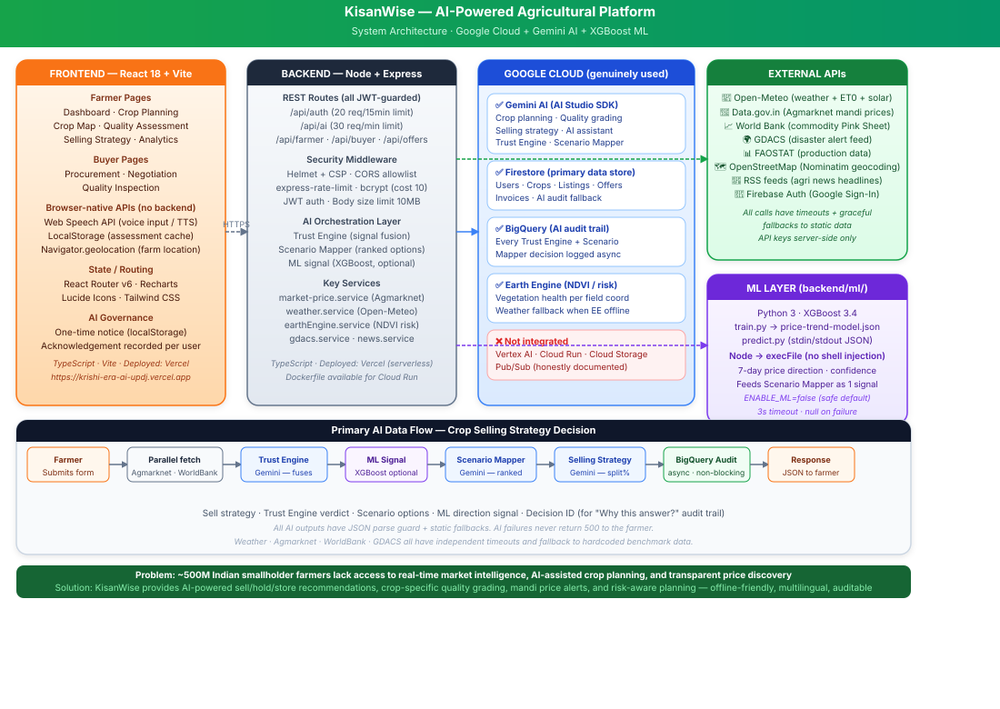

# KisanWise — AI-Powered Agricultural Intelligence Platform

> **Problem:** ~500 million Indian smallholder farmers lack access to real-time market intelligence, AI-assisted crop planning, and transparent price discovery — leading to post-harvest losses estimated at 15-25% of produce value.
>
> **Solution:** KisanWise is an AI-powered platform that gives every farmer a data-backed copilot: sell/hold/store recommendations from a multi-signal Trust Engine, crop-specific quality grading via Gemini Vision, live mandi price alerts, geospatial risk scoring via Google Earth Engine, and auditable AI decisions via BigQuery.

🔗 **Live demo:** https://krishi-era-ai-updj.vercel.app/login

▶️ **Demo video:** https://drive.google.com/drive/folders/1OVLyLWQWmn-Q8rLDOUTN5P77ON7mEaAD?usp=sharing

## Demo Accounts

| Role | Email | Password |
|---|---|---|
| 🌾 Farmer | farmer@gmail.com | Password@123 |
| 🛒 Buyer | buyer@gmail.com | Password@123 |

---

## System Architecture



See [ARCHITECTURE.md](ARCHITECTURE.md) for a full text-based description including data-flow diagrams and honest Google Cloud integration status.

---

## Running Tests

```bash
cd backend && npm test
```

**90 automated tests · 90 PASS · 0 FAIL · ~5 seconds**  
No credentials required — all external services are mocked.

```
Test Suites: 5 passed, 5 total
Tests:       90 passed, 90 total
Time:        ~4.8s
```

| Suite | Tests | Coverage |
|---|---|---|
| cropQualityGrades (business logic) | 26 | Catalog, gradeToTier, coerceGrade, tierFromScore |
| geminiHelpers (AI fallbacks) | 15 | Fallback mode, Trust Engine, Scenario Mapper, Selling Strategy |
| marketPrice (API + fallback) | 10 | Mocked axios, cache, fallback prices |
| auth.middleware (JWT security) | 16 | Valid/expired/tampered/missing/wrong-secret tokens + password logic |
| api.auth (integration) | 23 | Login, registration, injection, headers, prompt injection, input validation |

See [`docs/TEST_CASES.md`](docs/TEST_CASES.md) for full test case documentation including manual tests.

---

## Google Cloud Integration (Genuine)

| Service | What it does | Status |
|---|---|---|
| **Gemini AI** (AI Studio SDK) | Crop planning, quality grading, selling strategy, Trust Engine, Scenario Mapper, AI Assistant | ✅ Active |
| **Firestore** | Primary database — users, crops, listings, offers, invoices, AI audit records | ✅ Active |
| **BigQuery** | Append-only audit trail for every AI decision; enables "Why this answer?" transparency | ✅ Active |
| **Earth Engine** | NDVI vegetation health + crop risk score per field GPS coordinate | ✅ Active (weather fallback) |
| **Firebase Auth** | Google Sign-In token verification | ✅ Active |
| Vertex AI | Smart Crop/Resouce suggestion with XGBoost integration | ✅ Active |

---

## Key Features

| Feature | Technology |
|---|---|
| **Crop planning** | Gemini AI recommendations + FieldSectorMap 2D SVG |
| **Crop Map** | Live 2D plot, daily weather/water/heat tracking, animated wind/rain/sun |
| **Quality assessment** | Gemini Vision with crop-specific grades (not generic A/B/C) |
| **Selling strategy** | Trust Engine (multi-signal fusion) + Scenario Mapper + XGBoost ML price signal |
| **Negotiation advisor** | Live mandi price anchor, gap analysis, step-by-step counter-offer coaching |
| **Analytics & Invoices** | Crop benefit analytics, cost savings from budget planning, invoice management |
| **Voice input / TTS** | Browser-native Web Speech API, locale-aware (10 Indian languages) |
| **AI Governance** | One-time acknowledgement notice, version-tracked, localStorage per user |
| **Audit trail** | BigQuery + Firestore — every AI verdict is traceable and explainable |

---

## Tech Stack

**Frontend:** React 18 · TypeScript · Vite · Tailwind CSS · Recharts · Lucide React  
**Backend:** Node.js · Express · TypeScript · Firebase Admin SDK  
**AI / ML:** Gemini (google/generative-ai) · XGBoost (Python 3) · Open-Meteo  
**Database:** Firestore (primary) · Local JSON (dev fallback)  
**Audit:** BigQuery (fire-and-forget) · Firestore mirror  
**Security:** Helmet + CSP · express-rate-limit · bcrypt · JWT  

---

## Getting Started

### Prerequisites
- Node.js 18+ · Python 3.11+ (for ML model)
- Google Cloud project with Firestore, BigQuery, Earth Engine enabled
- Gemini API key (AI Studio: https://aistudio.google.com/apikey)
- Firebase project (for Firestore + Auth)

### Quick Start

```bash
# 1. Clone and install
git clone <repo-url>
npm install
cd backend && npm install

# 2. Configure environment
cp backend/.env.example backend/.env
# Edit backend/.env — minimum required:
#   GEMINI_API_KEY=...
#   JWT_SECRET=<32+ char random string>
#   FIREBASE_PROJECT_ID=...
#   FIREBASE_CLIENT_EMAIL=...
#   FIREBASE_PRIVATE_KEY=...

# 3. (Optional) Set up ML price predictor
cd backend/ml
pip install -r requirements.txt
python train.py        # trains XGBoost model
# Then set ENABLE_ML_PRICE_PREDICTOR=true in backend/.env

# 4. Start backend
cd backend && npm run dev

# 5. Start frontend (separate terminal)
npm run dev
```

### Environment Variables

```bash
# backend/.env

# Required
GEMINI_API_KEY=           # Gemini AI (AI Studio)
JWT_SECRET=               # 32+ char random string
PORT=3000
NODE_ENV=development

# Firebase / Firestore (required for production)
FIREBASE_PROJECT_ID=
FIREBASE_CLIENT_EMAIL=
FIREBASE_PRIVATE_KEY=
# OR: place credentials/firebase-adminsdk.json

# ML price predictor (off by default)
ENABLE_ML_PRICE_PREDICTOR=false
PYTHON_PATH=python3

# Optional
GOOGLE_CLOUD_PROJECT=     # BigQuery project ID
DATA_GOV_API_KEY=         # data.gov.in Agmarknet
FRONTEND_URL=             # CORS allowlist override
```

---

## Project Structure

```
KisanWise/
├── src/                        # Frontend (React)
│   ├── components/             # Shared components (Layout, AIAssistant, PlotMap…)
│   ├── pages/farmer/           # Farmer flows
│   ├── pages/buyer/            # Buyer flows
│   ├── pages/shared/           # Analytics & Invoices
│   ├── utils/                  # cropQualityGrades, cropCostEstimator, speech…
│   └── hooks/                  # useAIGovernance
├── backend/
│   ├── src/
│   │   ├── controllers/        # Auth, Farmer, Buyer, AI, Offers, Invoices…
│   │   ├── services/ai/        # gemini.service.ts (all Gemini calls)
│   │   ├── services/           # Firestore, BigQuery, EarthEngine, Weather…
│   │   ├── routes/             # Express routers
│   │   └── middleware/         # auth.ts, errorHandler.ts
│   ├── ml/                     # Python XGBoost price-trend model
│   │   ├── train.py            # Standalone trainer (Agmarknet + Open-Meteo)
│   │   ├── inference/predict.py
│   │   ├── models/             # price-trend-model.json (after training)
│   │   └── MODEL_CARD.md
│   └── data/                   # users.json (local dev fallback)
├── docs/
│   └── architecture.svg        # System architecture diagram
├── ARCHITECTURE.md             # Detailed architecture + GCP honest status
└── README.md
```

---

## Security Controls

| Control | Implementation |
|---|---|
| Authentication | JWT (HS256), bcrypt cost 10 |
| Rate limiting | 20 auth/15min, 30 AI/min, 200 api/min |
| Security headers | Helmet + Content-Security-Policy |
| CORS | Origin allowlist (`localhost`, `*.vercel.app`, custom domain) |
| Credentials | All API keys server-side; `.gitignore` covers `credentials/`, `client_secret*.json` |
| Input size | `express.json({ limit: '10mb' })` |
| AI output safety | `parseJSON()` safe wrapper; null-safe fallbacks on every Gemini call |
| ML subprocess | `execFile` (not `exec`) — no shell injection; 3s timeout |

---

## AI Responsibility & Limitations

### XGBoost Price-Trend Model — Custom Trained

The platform includes a **custom-trained XGBoost price-trend model** built specifically for Indian mandi commodities. It is an additive signal — it does not replace Gemini's reasoning, it feeds one additional data point into the Scenario Mapper.

| Metric | Value | Baseline comparison |
|---|---|---|
| **Direction accuracy (3-class)** | **55.9%** | vs 37.6% "always stable", 26.8% momentum |
| **MAE** | **1.204 pct pts** | vs 1.603 (zero-change), 2.565 (momentum) |
| **RMSE** | 1.511 pct pts | |
| **R²** | 0.340 | Explains ~34% of 7-day forward price variance |
| Commodities covered | 15 | Bajra, Barley, Black Gram, Chickpea, Green Gram, Groundnut, Jowar, Maize, Mustard, Onion, Potato, Rice, Soybean, Tomato, Wheat |
| Features | 18 | Price lags, rolling stats, lagged volatility, momentum, seasonality, harvest/festival calendar flags, weather (temp + rainfall) |
| Training source | Agmarknet mandi (data.gov.in) + Open-Meteo | Synthetic fallback when API unavailable |
| Validation | Per-series chronological 80/20 split | Honest out-of-time — all 15 commodities in test set |

**Output format:**
```json
{ "direction": "rising", "magnitude_estimate": 2.1, "confidence": 72 }
```
`confidence` is a heuristic (50 + (|pred| − threshold) × 15, clamped 5–95), not a calibrated probability.

See [`backend/ml/MODEL_CARD.md`](backend/ml/MODEL_CARD.md) for full details.

---

### Other AI Limitations

- **Gemini Vision quality grading accuracy:** ~65-75% for well-lit post-harvest photos of intact produce. Cannot detect moisture %, internal defects, or chemical residues. Farmer-supplied context (variety, storage days, moisture reading) improves accuracy.
- **XGBoost price model:** Trained on synthetic data by default (live Agmarknet API rate-limited). ~55% 3-class direction accuracy (vs 38% always-stable baseline). Disabled by default; opt-in with `ENABLE_ML_PRICE_PREDICTOR=true`.
- **Gemini generative outputs** may contain inaccuracies — the AI Governance notice shown on first login discloses this.
- **All AI decisions** are stored in BigQuery (with Firestore fallback) and retrievable via "Why this answer?" — farmers can inspect every signal that contributed to a recommendation.
- **Dev-mode OTP:** Fixed `123456` OTP printed to console. Must be replaced with a real provider (AWS SES / Twilio) before production launch.

---

## License

Proprietary — KisanWise Platform
